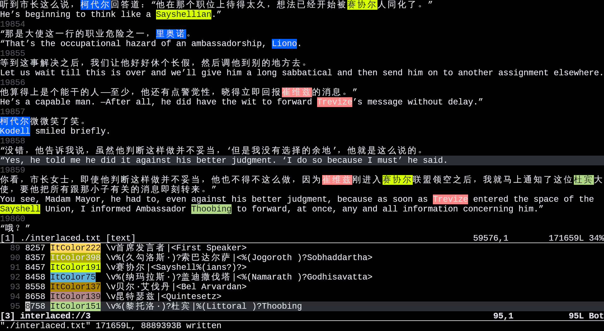

# interlaced.nvim

Text re-positioning for bilingual sentence alignment.



## Requirements

+ Neovim >= **0.12.0**

## Installation

+ Using [lazy.nvim](https://github.com/folke/lazy.nvim)

```lua
{
  "tanloong/interlaced.nvim",
  config = function() require("interlaced") end,
  ft = "text",
}
```

## Configuration

Use `vim.g.interlaced` option table and modifiy the field what you need before the plugin is loaded.

```lua
vim.g.interlaced = {
  keymaps = {
    { "n", ",", "push_up"},
    { "n", "<", "push_up_pair"},
    { "n", "e", "push_up_left_part"},
    { "n", ".", "pull_below"},
    { "n", ">", "pull_below_pair"},
    { "n", "d", "push_down_right_part"},
    { "n", "D", "push_down"},
    { "n", "s", "leave_alone"},
    { "n", "[e", "swap_with_above"},
    { "n", "]e", "swap_with_below"},
    { "n", "U", "undo"},
    { "n", "R", "redo"},
    { "n", "J", "navigate_down"},
    { "n", "K", "navigate_up"},
    { "n", "md", "dump"},
    { "n", "ml", "load"},
    { "n", "gn", "startlux_op"},
    { "n", "mt", "match_toggle"},
    { "n", "m;", "list_matches"},
    { "n", "ma", "match_add"},
    { "v", "ma", "match_add_visual"},
  },
  -- sentence separator inserted when pushing/pulling a line up, keyed by the
  -- 1-based language position
  language_separator = { ["1"] = "", ["2"] = " " },
  lang_num = 2,
  -- max re-positioning operations remembered by `:Interlaced undo`; <= 0 means unlimited
  undo_limit = 100,
  enable_keybindings_hook = function()
    -- disable coc to avoid lag on :w
    if vim.g.did_coc_loaded ~= nil then vim.cmd [[CocDisable]] end
    -- disable the undo history saving, which is time-consuming and causes lag
    vim.opt_local.undofile = false
    -- pcall(vim.cmd.nunmap, "j")
    -- pcall(vim.cmd.nunmap, "k")
    -- pcall(vim.cmd.nunmap, "gj")
    -- pcall(vim.cmd.nunmap, "gk")
    -- vim.opt_local.undolevels = -1
    vim.opt_local.signcolumn = "no"
    vim.opt_local.relativenumber = false
    vim.opt_local.number = false
    require "interlaced".action.load()
    require "interlaced".ShowChunkNr()
  end,
  ---@type function|nil
  disable_keybindings_hook = nil,
}
```

## Health check

`:checkhealth interlaced` reports the active configuration and whether the Neovim version and options are valid.

## Finding the first unaligned pair

`:Interlaced startlux_op` looks at the window, asks the StartLux Decision API for the **first** chunk whose Chinese and English do not match, then sends a second, focused request containing the previous/current/next chunks and asks for one **whole-line, pair, or inline** operation: `push_up`, `pull_below`, `push_down`, `push_up_pair`, `pull_below_pair`, `push_up_left_part`, `push_down_right_part`, or `leave_alone`. It only suggests the operation — the cursor is moved to the target line (and split column) and the pair flashes, but the buffer is not modified. This makes it easy to try the suggestion with the normal keymaps and undo it if needed. With the default keymaps it is bound to `gn`.

Only the first unaligned chunk is asked for on purpose: a boundary error shifts every later chunk by one, so once the first one is fixed everything below it lines up again. The locating request is a single `choice` question over the chunks in the window, so the round trip stays short.

For an inline operation (`push_up_left_part` / `push_down_right_part`), a third, tiny request picks the split point from the safe candidates of the target line. Chinese lines allow every character boundary; English lines only offer word starts, so a word is never cut in half. Punctuation and common Chinese discourse markers are kept first when the candidate list is capped by `split_max_options`.

`:Interlaced startlux_apply` runs the same requests and executes the suggested operation (whole-line, pair, or inline), so `:Interlaced undo` can revert it. If the window contains no unaligned chunk (chunks cut by the window edges are ignored), it scrolls one page forward with `<C-F>` instead, without going through user mappings; run it again to continue from the new page.

`startlux_op` and `startlux_apply` make two requests, or three when the suggestion is an inline operation. They all go to `POST {base_url}/decisions`, the same endpoint the OpenCode `startlux_decision` tool uses. The key is read from `$BAMBOO_API_KEY`, `$STARTLUX_API_KEY`, the `api_key` option, then `~/.config/opencode/bamboo-api-key`.

`:Interlaced startlux_prompt` opens a scratch buffer with the exact first-unpair request (the numbered window and the one question), which is handy for inspecting or pasting the prompt elsewhere.

This feature is self-contained in its own file, `lua/interlaced/startlux.lua`, which `require "interlaced"` loads along with everything else — there is nothing to add to your config. The module also works standalone (`require "interlaced.startlux"`).

| command | description |
| - | - |
| **:Interlaced startlux_op**  | locates the first unpair, suggests a whole-line/pair/inline operation, and moves the cursor to its target line (and split column). Does not modify the buffer. |
| **:Interlaced startlux_apply**  | locates the first unpair and applies the suggested whole-line/pair/inline operation. Pages down with `<C-F>` when the window has no unpair. |
| **:Interlaced startlux_cancel**  | drops the in-flight request. |
| **:Interlaced startlux_prompt**  | shows the first-unpair request that would be sent, in a scratch buffer. |

`startlux_op` is bound to `gn` by default; `startlux_apply` is not bound. Add it to `vim.g.interlaced.keymaps` if you want a key, e.g. `{ "n", "<leader>a", "startlux_apply" }`.

Options live in `vim.g.interlaced.startlux` (the flat `vim.g.interlaced_startlux` works too):

| option | default | description |
| - | - | - |
| `base_url` | `"https://api.bamboonode.dev/v1"` | OpenAI-compatible base URL; `/decisions` is appended |
| `model` | `"startlux-decision-27b-autothink"` | model id sent in the request body |
| `api_key` | `nil` | bearer token; `nil` falls back to the environment and `key_file` |
| `key_file` | `"~/.config/opencode/bamboo-api-key"` | read when no environment variable or `api_key` is set |
| `think_mode` | `"never"` | `"auto"` lets the model think when unsure, at the cost of latency |
| `timeout_s` | `20` | how long curl may take for the whole request |
| `curl` | `"curl"` | curl executable used for the HTTPS call |
| `highlight_ms` | `1200` | how long the pair stays highlighted |
| `highlight_group` | `"InterlacedUnpairFlash"` | highlight group of the flashed lines (linked to `IncSearch`) |
| `max_options` | `80` | how many chunks are offered as choices; longer windows are cut off |
| `split_max_options` | `60` | how many split points are offered for an inline operation |

```lua
vim.g.interlaced = {
  startlux = {
    think_mode = "auto",
    highlight_ms = 2000,
  },
}
```

Assign the whole `vim.g.interlaced` table in one go: Neovim hands `vim.g` back as a copy, so `vim.g.interlaced.startlux.think_mode = "auto"` afterwards is silently lost.

## Asking DeepSeek about the current window

`:Interlaced deepseek [extra instruction]` sends three things to a DeepSeek chat page in your browser:

1. the local prompt file (`p.md` by default),
2. the lines currently visible in the window, and
3. the cursor line with a `|` marking the cursor column,

plus the optional extra instruction. The text is typed into the page and sent; you read DeepSeek's answer in that tab. Nothing is fetched back, so no window is opened and Neovim stays responsive.

The browser half lives in [`deepseek/`](deepseek/README.md): a dependency-free Node service plus an unpacked extension that types into the page and presses send. Set it up once:

```sh
node deepseek/server.mjs   # or let Neovim start it for you
```

Load `deepseek/extension` through `edge://extensions` → Developer mode → Load unpacked, then keep a `chat.deepseek.com` tab open.

These subcommands are **not bound by default**. To bind the plain send, add `{ "n", "<leader>d", "deepseek" }` to `vim.g.interlaced.keymaps`.

| command | description |
| - | - |
| **:Interlaced deepseek [instruction]**  | sends the prompt file, the visible window and the cursor line to DeepSeek and presses send in the browser tab. The optional argument is appended to the prompt file as an extra instruction. |
| **:Interlaced deepseek_status**  | reports whether the service is running and which DeepSeek page is connected. |
| **:Interlaced deepseek_cancel**  | drops the in-flight send. |

Options live in `vim.g.interlaced.deepseek` (the flat `vim.g.interlaced_deepseek` works too):

| option | default | description |
| - | - | - |
| `host` | `"127.0.0.1"` | where the bridge listens |
| `port` | `8765` | must match the service and `deepseek/extension/content.js` |
| `prompt_file` | `"p.md"` | sent as the prompt; a relative path is looked up in the current directory and then next to the buffer |
| `auto_start` | `true` | start `node deepseek/server.mjs` when the service is not running yet |
| `node` | `"node"` | Node.js executable used by `auto_start` |
| `server_script` | `<repo>/deepseek/server.mjs` | script run by `auto_start` |
| `log_file` | `nil` | file the auto-started service writes its log to; `nil` uses a timestamped file in the temp directory (the path is reported in the notification) |
| `timeout_ms` | `15000` | how long the browser page may take to type the text and press send |
| `status_timeout_ms` | `5000` | how long `:Interlaced deepseek_status` waits for the service |

```lua
vim.g.interlaced = {
  deepseek = {
    prompt_file = "~/.config/nvim/interlaced-prompt.md",
    port = 9000,
  },
}
```

Assign the whole `vim.g.interlaced` table in one go: Neovim hands `vim.g` back as a copy, so `vim.g.interlaced.deepseek.port = 9000` afterwards is silently lost.

With `auto_start`, the service is a detached child of Neovim, so it inherits Neovim's standard output. That is invisible in a terminal, but a launcher that waits for Neovim's output to finish will wait for the service too — start the service yourself (and set `auto_start = false`) if that applies to you.


## Chunk numbers and counted navigation

`:Interlaced toggle_chunk_number` (or `require "interlaced".ShowChunkNr()` in your config) writes the chunk number onto the blank separator after each chunk. The numbers are absolute by default; `:Interlaced toggle_chunk_number_relative` switches them between absolute and relative for all buffers:

- absolute: every chunk shows its absolute number.
- relative: the chunk containing the cursor shows its absolute number, and every other chunk visible in the window shows its distance from the cursor chunk. A chunk labelled `2` is two chunks away, so `2J` or `2K` jumps to it.

Showing chunk numbers also turns off the system `number` and `relativenumber` columns in every window displaying the buffer, so only the plugin's virtual text remains. The labels are refreshed on cursor movement, scrolling, and window resizing; they do not depend on the system options.

`navigate_down`, `navigate_up`, `next_unaligned`, and `prev_unaligned` accept a `[count]`. With the default keymaps `3J` moves three chunks down and `2K` two chunks up; from the command line use `:Interlaced navigate_down 3` or `:Interlaced next_unaligned 2`. For the two `unaligned` actions the count is the number of *unaligned* chunks to skip; if fewer remain than requested, the cursor stops on the furthest one found and a message reports the shortfall.

## Development

```sh
make test   # run tests/test_*.lua with a clean Neovim
make doc    # regenerate doc/interlaced.nvim.txt (requires vimcats)
```

The DeepSeek bridge service needs no dependencies:

```sh
node deepseek/server.mjs --port 8765
```

## Commands

| command | description |
| - | - |
| **:Interlaced enable_keybindings**  | applies keybindings specified in the `keymaps` field in `vim.g.interlaced`. Original keymaps are backed up. |
| **:Interlaced disable_keybindings**  | cancels `keymaps` keybindings and restores backed up keymaps. |
| **:Interlaced split_english_sentences**  | identifies English sentence endings and insert a newline after each of them. Works linewise on the range when provided, the whole buffer if not. |
| **:Interlaced split_chinese_sentences**  | ibidem but identifies Chinese sentence endings. |
| **:Interlaced interlace_with_l1 {filepath}**  | mixes non-empty lines from current buffer with those from `filepath` into empty-line-separated pairs of lines. In each pair, lines from `filepath` are above those from current buffer. `keymaps` keybindings are enabled if they have not been previously. |
| **:Interlaced interlace_with_l2 {filepath}**  | ibidem but lines from `filepath` are below those from current buffer. |
| **:[range]Interlaced interlace [num]**  | mixes non-empty lines from current buffer into `num` empty-line-separated chunks. Works on the range when provided, the whole buffer if not. If `num` is not provided, `lang_num` field of the `vim.g.interlaced` will be used. |
| **:[range]Interlaced deinterlace [num]**  | Works on the range when provided, the whole buffer if not. If `num` is not provided, `lang_num` field of the `vim.g.interlaced` will be used. |
| **:Interlaced match_add**  | opens a matches window to edit a pattern to be highlighted. The window has 3 columns: match id, highlight group, and pattern. On pressing `<Enter>` in insert/normal mode, `matchadd()` will be called with the 3 values (see `:h matchadd()`). If match id is left as `_`, a random one will be chosen by `matchadd()` . If highlight group is left as `_`, a random one will be chosen from the plugin's [predefined ones](https://github.com/tanloong/interlaced.nvim/blob/dev/lua/interlaced/colors.lua). In normal mode, `D` deletes match of current line, `U` undoes the deletion, `R` switches a random color for the match under the cursor. |
| **:Interlaced match_add_visual**  | ibidem but populates the pattern column with the visually selected text. |
| **:Interlaced list_matches**  | opens the matches window. You can edit highlight groups or pattern there and press `<Enter>` to apply the change. |
| **:Interlaced clear_matches**  | removes all matches. This action cannot be undone. |
| **:Interlaced match_toggle**  | turns on/off highlighting for the matches. |
| **:Interlaced list_highlights**  | shows the predefined highlight groups of this plugin. |
| **:Interlaced swap_with_above**  | swaps current line with the counterpart line from the chunk above. |
| **:Interlaced swap_with_below**  | ibidem but from the chunk below. |
| **:Interlaced push_up [lineno]**  | appends the line at `lineno` up to the end of its counterpart at the chunk above. Subsequent counterpart lines are moved up correspondingly. Works on the current line if `lineno` is not provided. |
| **:Interlaced push_up_pair [lineno]**  | ibidem but works on every line in the chunk where `lineno` is at. |
| **:Interlaced push_up_left_part [lineno [colno]]**  | appends the text leftside of column `colno` at line `lineno` up to its counterpart in the chunk above, leaving line `lineno` with the text rightside of column `colno`. Works on the current line if `lineno` is not provided. Uses cursor position if `colno` is not provided. |
| **:Interlaced pull_below [lineno]**  | appends the counterpart at the chunk below to line `lineno`. Subsequent counterpart lines are moved up correspondingly. Works on the current line if `lineno` is not provided. |
| **:Interlaced pull_below_pair [lineno]**  | ibidem but works on every line in the chunk where `lineno` is at. |
| **:Interlaced push_down_right_part [lineno [colno]]**  | moves the text rightside of column `colno` at line `lineno` down to its counterpart at the chunk below, leaving lineno `lineno` with the text leftside of column `colno`. Subsequent counterpart lines are moved down correspondingly. Works on the current line if `lineno` is not provided. Uses cursor position if `colno` is not provided. |
| **:Interlaced push_down [lineno]**  | ibidem but moves down the whole line `lineno`, leaving it as empty. |
| **:Interlaced leave_alone [lineno]**  | pushes down all lines (except the cursor line) in the chunk where `lineno` is at, puts a `-` as placeholder at each, and moves cursor down to the next chunk. Works on the cursor chunk if `lineno` is not provided. |
| **:Interlaced next_unaligned [count]**  | moves cursor down to the `[count]`th chunk (default: the next one) that has different kinds of highlighted matches across its lines. |
| **:Interlaced prev_unaligned [count]**  | ibidem but moves cursor up. |
| **:Interlaced set_lang_num {num}**  | changes `lang_num`, i.e., how many lines should be in each chunk. This affects re-positioning actions (`Interlaced push_up(_pair)`, `Interlaced pull_below(_pair)`, `Interlaced push_down(_right_part)`, and `Interlaced leave_alone`). When called without argument or with a single `?` it shows the current value. |
| **:Interlaced set_separator {num} {str}**  | changes sentence separator to `str` for the `num`th language, i.e., what should be inserted between on `ItPushUp(Pair|LeftPart)?` and `ItPullBelow(Pair)?`. When called without argument or with a single `?` it shows current values.  |
| **:Interlaced navigate_down [count]**  | moves cursor down by `count * (lang_num + 1)` lines; `count` defaults to 1. |
| **:Interlaced navigate_up [count]**  | moves cursor up by `count * (lang_num + 1)` lines; `count` defaults to 1. |
| **:Interlaced undo**  | undoes the last re-positioning action. The undo list remembers at most `undo_limit` (default 100) re-positionings and forgets oldest ones thereafter. A non-positive `undo_limit` makes the list unlimited. It costs too much RAM to remember changes of an interlaced buffer, because re-positioning affects every counterpart line from the cursor below, and the builtin *undo history* stores all of that. One `Interlaced push_up` at the beginning of an interlaced buffer with 190k lines increases memory use by 100M. To avoid memory creep, the plugin has an isolated *operation history* for re-positioning operations (`Interlaced push_up(_pair)`, `Interlaced pull_below(_pair)`, `Interlaced push_down(_right_part)`, and `Interlaced leave_alone`). It disables the builtin *undo history* recording before a re-positioning operation is called, appends the operation to its *operation history*, and enables the *undo history* afterwards. Note that the builtin *undo history* is cleared every time an re-positioning operation is called. Use `:Interlaced undo` to undo a re-positioning operation. Use the traditional `u` to undo normal text changes like inserting, pasting, etc. |
| **:Interlaced redo**  | undoes the last `Interlaced undo`. |
| **:Interlaced toggle_chunk_number**  | shows/hides chunk numbers on the separator lines. The numbers are absolute by default; use `toggle_chunk_number_relative` for relative numbers. |
| **:Interlaced toggle_chunk_number_relative**  | switches chunk numbers between absolute and relative for all buffers. In relative mode the cursor chunk is absolute and the other visible chunks are relative to it. |
| **:Interlaced dump [filepath]**  | saves workspace to `filepath`: cursor position, matches, language separator, and `lang_num`. Undo and redo lists are not saved. Uses `./.interlaced.json` when called without argument. |
| **:Interlaced load [filepath]**  | loads workspace from `filepath`. Uses `./.interlaced.json` when called without argument. |
